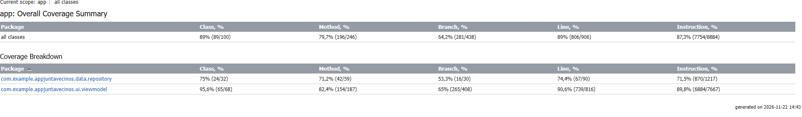
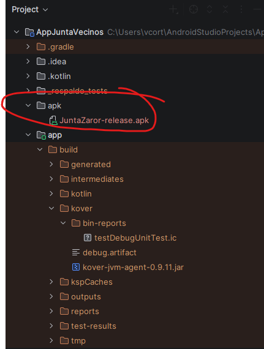
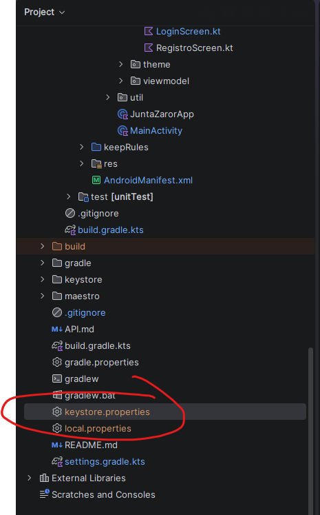

# Junta Zaror

App Android de la **Junta de Vecinos Población Zaror** para reservar las sedes comunitarias y dar
transparencia financiera a los vecinos, con un backend de microservicios en Spring Boot.

## Usuarios de prueba

Contraseña de todos: **`1234`**

| Correo | Rol |
|--------|-----|
| `camila@zaror.cl` | Vecina |
| `luis@zaror.cl` | Vecino |
| `directiva@zaror.cl` | Directiva |
| `tesorero@zaror.cl` | Tesorero |

**Tarjeta de prueba de Webpay** (ambiente de integración de Transbank, sin cobros reales):

| Dato | Valor |
|------|-------|
| Tarjeta VISA | `4051 8856 0044 6623` |
| CVV | `123` |
| Vencimiento | cualquier fecha futura |
| RUT (banco) | `11.111.111-1` |
| Clave | `123` |

## Integrantes

Victor Cortez y Catalina Correa · DSY1105 · grupo 10

## Funcionalidades

**Vecino**
- Registro e inicio de sesión
- Inicio con saldo de la junta y próximos feriados (API Nager.Date)
- Solicitar arriendo de una sede (fecha, horario, motivo y asistentes)
- Ver sus reservas, cancelarlas y pagarlas con Webpay o ver los datos de transferencia
- Ver las finanzas del mes y los informes de rendición publicados
- Editar su perfil

**Directiva**
- Aprobar o rechazar solicitudes de arriendo con una observación
- Calendario de ocupación por sede
- Ver las finanzas y los informes

**Tesorero**
- Registrar ingresos y gastos con foto de la boleta (cámara o galería)
- Editar, anular y ver el comprobante de los movimientos
- Registrar pagos manuales de arriendos (transferencia o efectivo) y ver todos los pagos
- Crear informes de rendición (borrador o publicado)

## Arquitectura

```
                         ┌───────────────────────────────┐
                         │  Gateway :8080  (valida JWT)  │──── Eureka :8761
App Android ─(Retrofit)─►│                               │
                         └──┬─────────┬─────────┬─────────┘
                            ▼         ▼         ▼         ▼
                         ms-auth  ms-usuario ms-reserva ms-finanza ──► Webpay (Transbank)
                            └─────────┴────┬────┴─────────┘
                                           ▼
                                      MySQL 8

App Android ─(Retrofit separado, sin token)─► API externa Nager.Date
```

## Endpoints utilizados

### Microservicios (vía gateway `http://10.0.2.2:8080/`)

Roles: **Todos** = cualquier usuario con sesión · **D** = Directiva · **T** = Tesorero.

| Método | Ruta | Rol | Para qué |
|--------|------|-----|----------|
| POST | `/api/auth/login` | Público | Iniciar sesión (devuelve el token JWT) |
| POST | `/api/auth/register` | Público | Registrarse como vecino |
| GET | `/api/usuarios/me` | Todos | Ver mi perfil |
| PUT | `/api/usuarios/me` | Todos | Editar mi perfil |
| GET | `/api/sedes` | Todos | Listar sedes con fotos y precio |
| GET | `/api/sedes/{id}/disponibilidad?anio=&mes=` | Todos | Horarios ocupados de una sede |
| POST | `/api/reservas` | Todos | Solicitar un arriendo |
| GET | `/api/reservas/mias` | Todos | Mis reservas |
| GET | `/api/reservas?estado=` | D, T | Todas las reservas (filtro por estado) |
| PUT | `/api/reservas/{id}/estado` | D | Aprobar o rechazar una reserva |
| DELETE | `/api/reservas/{id}` | Dueño | Cancelar mi reserva |
| GET | `/api/finanzas/resumen?anio=&mes=` | Todos | Saldo, ingresos y gastos del mes |
| GET | `/api/categorias` | T | Categorías de ingresos y gastos |
| GET | `/api/movimientos?anio=&mes=` | D, T | Movimientos del mes |
| POST | `/api/movimientos` | T | Registrar movimiento (multipart con foto opcional) |
| PUT | `/api/movimientos/{id}` | T | Editar movimiento |
| DELETE | `/api/movimientos/{id}` | T | Anular movimiento |
| GET | `/api/pagos` | D, T | Listar pagos |
| POST | `/api/pagos` | T | Registrar pago manual (multipart con comprobante) |
| POST | `/api/pagos/webpay/iniciar` | Vecino dueño | Iniciar el pago con Webpay |
| GET | `/api/informes` | Todos | Listar informes (el vecino solo ve los publicados) |
| GET | `/api/informes/{id}` | Todos | Detalle de un informe con totales |
| POST | `/api/informes` | T | Crear informe |

Las imágenes (`/api/sedes/fotos/{archivo}` y `/api/movimientos/{id}/comprobante`) se cargan con Coil.

### API externa

| Método | URL | Para qué |
|--------|-----|----------|
| GET | `https://date.nager.at/api/v3/publicholidays/{anio}/CL` | Feriados de Chile del año |

## Pasos para ejecutar

**Backend** (requiere Docker Desktop)

```bash
cd backend
cp .env.example .env          # completar los valores (ver backend/README.md)
docker compose up -d --build
```

Esperar **1 minuto** y revisar <http://localhost:8761>: deben aparecer MS-AUTH, MS-USUARIO,
MS-RESERVA, MS-FINANZA y MS-GATEWAY.

**App**

1. Abrir la carpeta `app/` en Android Studio.
2. Hacer **Gradle Sync**.
3. **Run** en el emulador.

> El proyecto usa el **mirror de Google para Maven Central** (la red de DUOC bloquea Maven Central),
> tanto en Gradle como en Maven/Docker. La app apunta a `http://10.0.2.2:8080/`, que es el PC visto
> desde el **emulador** de Android.

## Pruebas unitarias

JUnit + MockK · **69 pruebas** · cobertura **89 %** (Kover) en ViewModel y Repository.

```bash
cd app
./gradlew testDebugUnitTest koverHtmlReportDebug
```

Reporte: `app/app/build/reports/kover/htmlDebug/index.html`



## APK firmado

- APK: [`app/apk/JuntaZaror-release.apk`](app/apk/JuntaZaror-release.apk)
- Llave: [`app/keystore/junta-zaror.jks`](app/keystore/junta-zaror.jks)
- Firma configurada en `app/app/build.gradle.kts` (`signingConfigs`).
- Las contraseñas **no se suben**: van en `keystore.properties`, que está en `.gitignore`.




